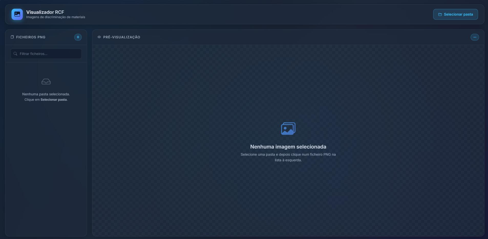

# RCF Decoder
Decoder tools in Python to read Rapiscan proprietary .RCF X-ray scans (Rapiscan 620XR).

| File             | Purpose |
| ---------------- |:-------------:|
| viewer.html      | Self-contained browser viewer: folder explorer, dual-energy views, region measurements. Works offline.     |
| decode.py        | Batch decoder: exports both energy channels to a preview PNG.     |

## Contains lightweight tools for viewing and decoding::
* viewer.html: standalone browser viewer (works offline), with folder explorer, dual power views and region measurements.
* decode.py: batch decoder and exports both power channels to .png files and generates a PNG preview

## Viewer
Open viewer.html in a recent browser (Chrome, Edge, Firefox, Safari). No server and no network access are needed; files are decoded locally and never leave the machine.

Open folder loads a folder tree; only .RCF files are listed.
Files are grouped by folder or by acquisition date, parsed from the file name <device>_<YYYYMMDDhhmmssSSS>_<tag>.RCF (e.g. 6201219_20261028162201833_SCREENER.RCF = 2026-10-28 16:22:01.833).
↑ / ↓ step through scans; the next scans are decoded in advance.

## Decoder

`pip install numpy pillow`  
`python decode.py path/to/`

Prints a smoothness score per file; a high score means the encoding differs from the validated one.
the output files is in the same folder. 

